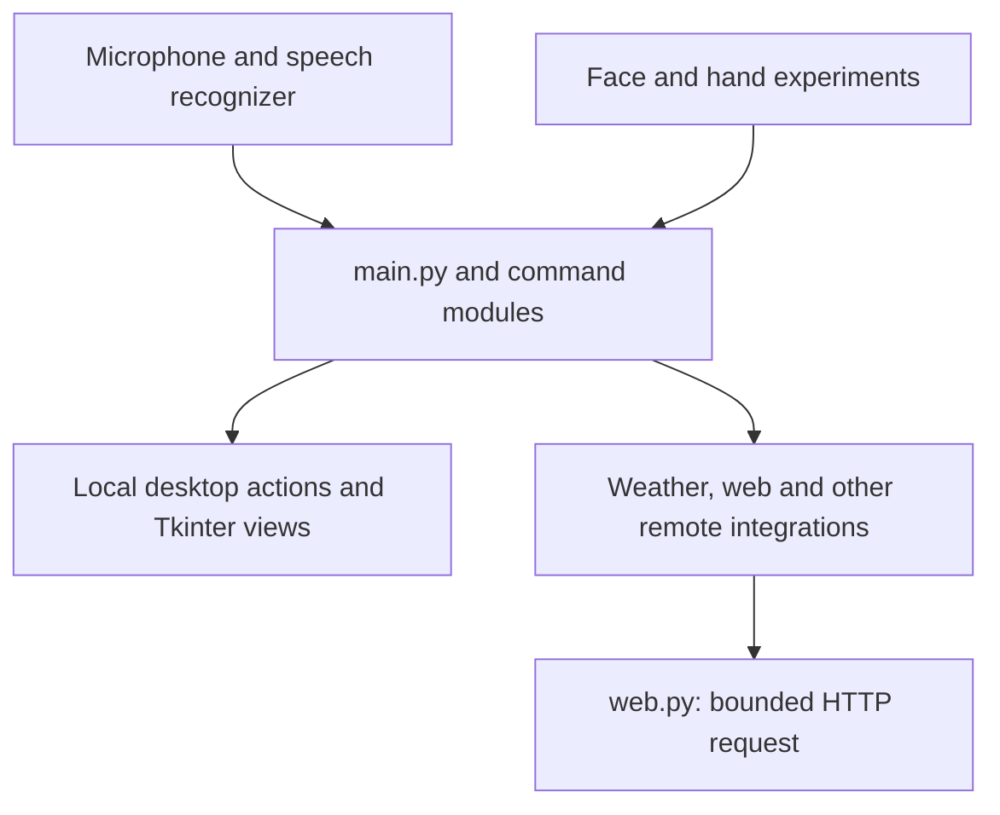

# Novah desktop automation coursework: architecture and maintenance

Reviewed source: `c5e55ca5de5784c06bb58be2ccee6c3610e91051`. Maintenance date: 11 November 2026. This document describes inspected code, the bounded fixes in this change and future work separately. It does not establish production deployment or measured scale. Original coursework/learning material and prior authorship remain identifiable; this maintenance was AI-assisted.

## Implemented architecture



| Component | Source | Responsibility |
| --- | --- | --- |
| Orchestration | Nova Software/main.py | Voice command routing to local automation modules. |
| Feature modules | Nova Software/web.py, weather.py, DT.py and others | Remote API retrieval, GUI views, notes, folders and app opening. |
| Authentication experiments | Nova Authentication | Academic face/hand work; not independently audited authentication. |
| Verification | tests/test_web.py and Unit and Integration Testing | New isolated HTTP behavior tests coexist with historical larger tests. |

## Engineering decisions in this change

The web scraper now supplies a 10-second timeout and handles request exceptions/HTTP failures. Importing web.py no longer activates the microphone. Existing API-key environment cleanup is retained. New tests isolate the network function without requiring audio hardware or making live requests.

## Reproduce checks and run

Run from the repository root with Python 3.12 or Node 22 as appropriate. Use a virtual environment before installing Python dependencies.

```bash
python -m unittest discover -s tests -v
python "Nova Software/main.py"
```

3 new regressions simulate timeout and HTTP errors and verify import-time microphone activation is absent. They do not import unavailable audio dependencies or contact external services.

## Current boundaries

The focused tests cover web-request failure semantics, not all GUI, speech, biometric or OS automation paths. Desktop actions need permissions and physical microphone/audio setup; many modules still target Windows. A timeout bounds waiting but does not make Tkinter networking asynchronous. Existing README feature wording is aspirational coursework behavior, not evidence of accessibility certification.

## Scaling path and acceptance evidence

Maintain a single command-dispatch interface with injectable speech, HTTP and OS adapters. Move network work to bounded background tasks and marshal GUI updates to the Tkinter thread. Add cancel/stop controls and explicit confirmations before filesystem actions. Share retry/time-budget rules by integration; avoid retrying side effects automatically. Measure command latency and failure/cancellation rate on supported OS setups.

## Maintenance and recovery

Keep data and credentials out of source changes. Reproduce a failure with synthetic inputs before modifying a transformation or user action. Run the focused CI checks, review changes to input/output contracts and retain the prior commit for rollback. Back up local CSV/database inputs outside the working tree before manual runs. Revert the maintenance commit to roll back code; preserve data separately because reverting code does not reverse data mutations. Record environment versions, input schema, failure steps and expected/actual behavior in future bug reports.
